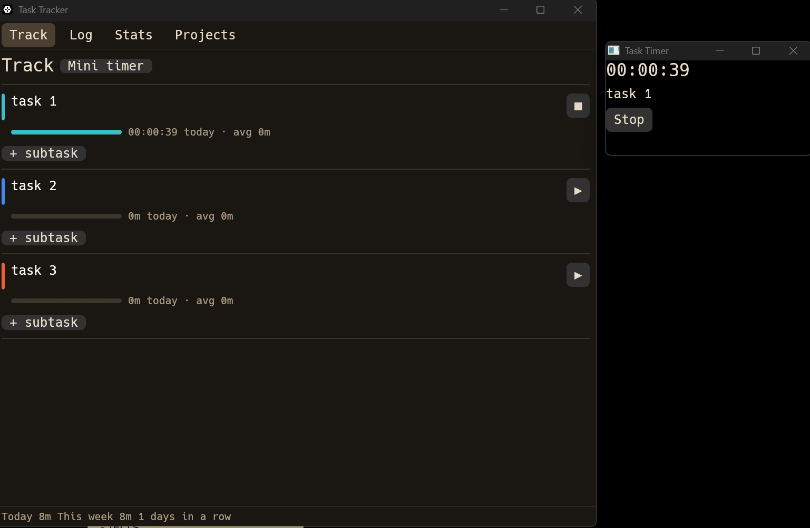

# Task Time Tracker

Minimal desktop time tracker in Rust (`eframe`/`egui`, warm dark theme).



## Features
- Projects + subtasks — add, **rename**, **archive**/unarchive, delete
  (archived projects hide from Track but keep their Log & Stats history)
- One active timer at a time (starting another auto-stops the current one)
- Live elapsed counter, per-project today + average, progress bars
- **Track / Log / Stats / Projects** tabs, 7-day / 30-day charts
- Bottom status bar: Today · This week · N days in a row
- **Floating always-on-top mini timer** (Show/Hide from the Track tab)
- **System tray icon** — beige when idle, **red** while a timer runs
  (tooltip shows the running task); left-click toggles the window,
  X minimizes to tray, Quit via the tray menu
- Closing the app auto-stops a running timer; a timer left running by a
  crash is stopped on next start

## Data
- Single file `tasks_data.json` in the **same folder as the `.exe`**
- Atomic writes (temp file + rename), plain JSON — copy it to back up

## Run / Build
```powershell
$env:Path = "D:\Rust\cargo\bin;$env:Path"
cargo run            # debug exe: target\debug\task-tracker.exe
cargo build --release  # release exe: target\release\task-tracker.exe
```
Copy the release `.exe` anywhere — `tasks_data.json` is created next to it
on first save. No console window in release builds.

## Toolchain (this machine)
- Rust stable `x86_64-pc-windows-gnu` in `D:\Rust` (`CARGO_HOME`/`RUSTUP_HOME`)
- Linker from WinLibs MinGW in `D:\mingw64\mingw64\bin` (on PATH)
